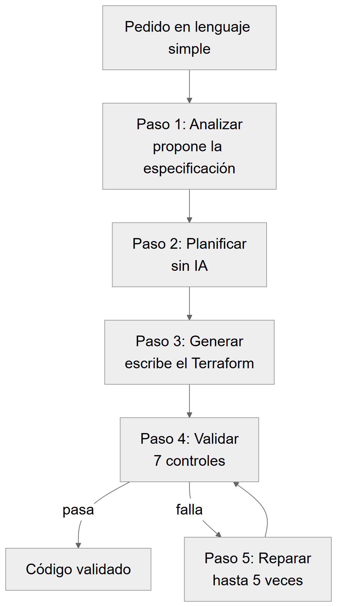
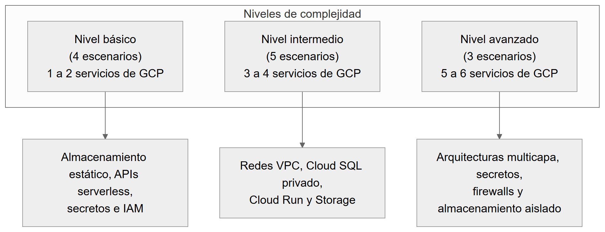
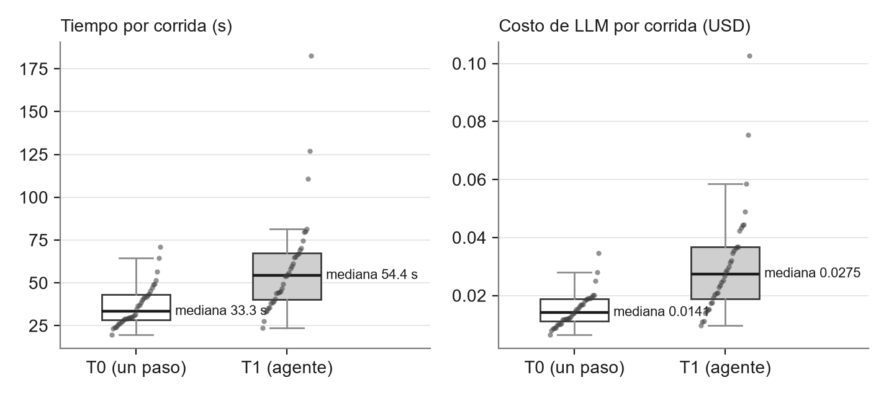
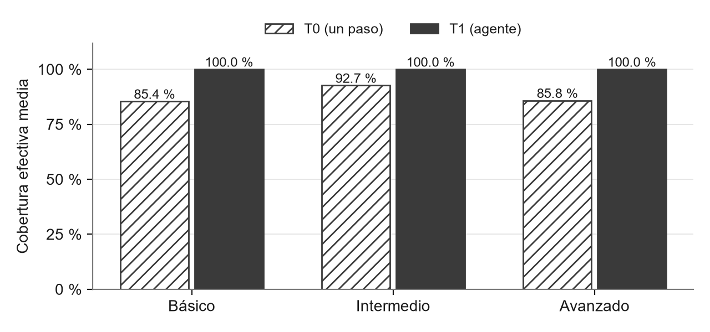
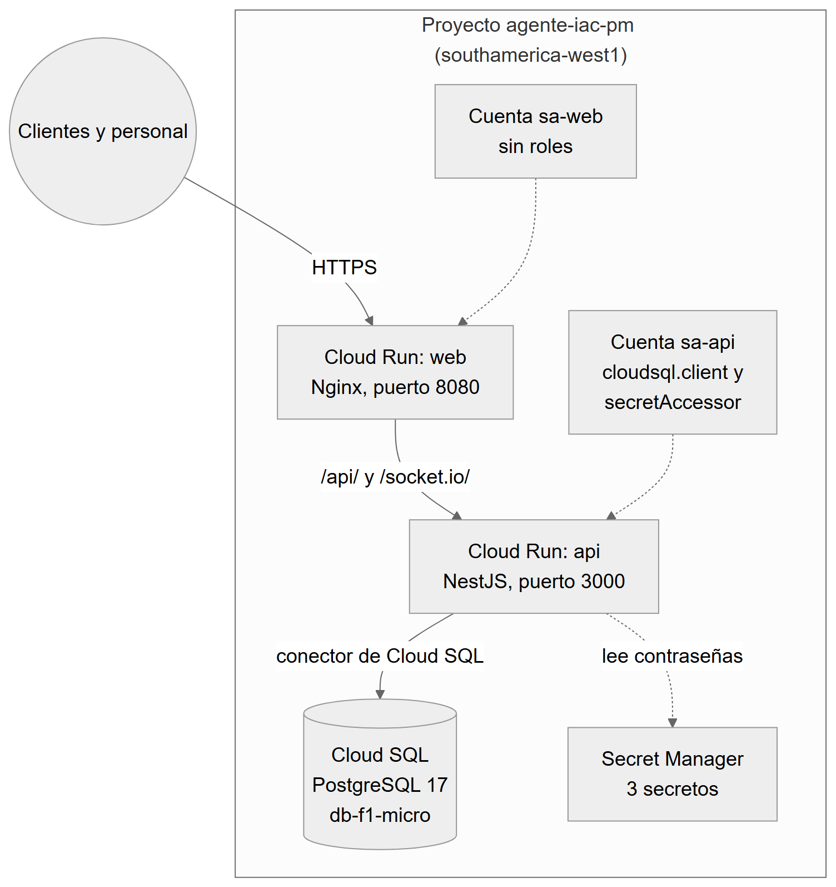
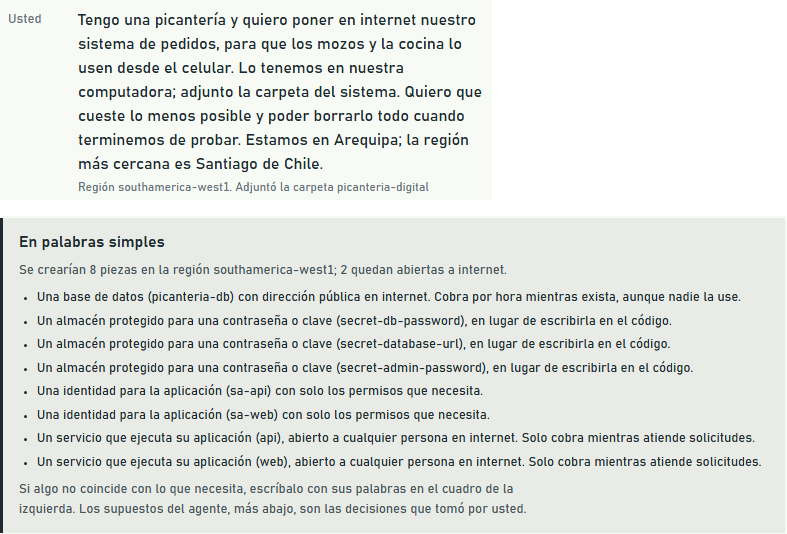
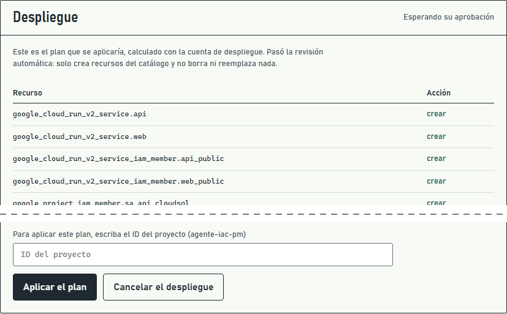
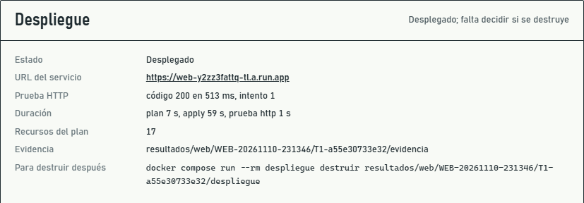
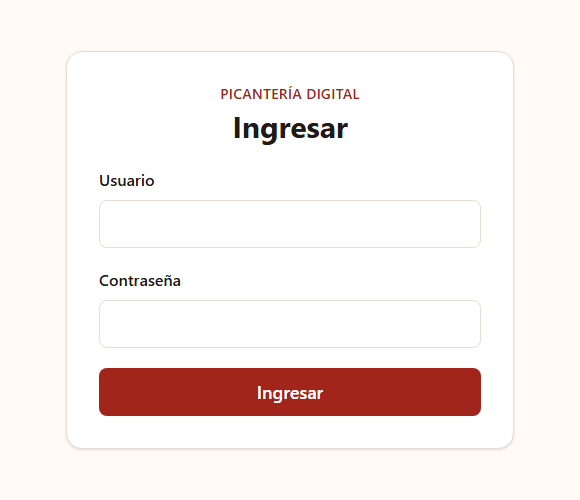
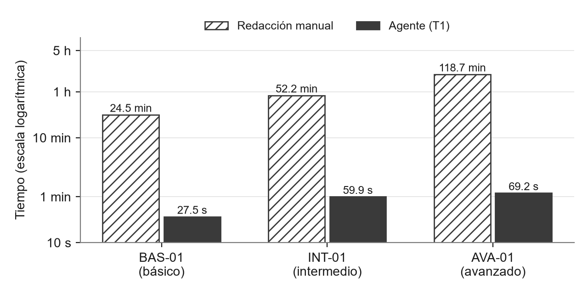

# RESUMEN

Escribir infraestructura como código con Terraform exige conocer muchos detalles de cada servicio de la nube. Los modelos de lenguaje grandes (LLM) pueden escribir ese código a partir de un pedido en lenguaje natural, pero se equivocan, y ejecutar su código sin control es riesgoso. En este trabajo se construyó un agente para Google Cloud Platform (GCP) que usa el modelo Gemini 3.8 Flash, revisa el código con herramientas automáticas dentro de un entorno aislado (sandbox) y lo corrige cuando falla.

Se comparó el agente completo (T1) con una generación en un solo paso (T0) en 12 escenarios y 72 corridas. Ambos produjeron código válido en casi todos los casos (T0: 97.2 %; T1: 100 %), sin diferencia significativa, por lo que no se rechaza la hipótesis nula. La ventaja de T1 fue incluir siempre todos los recursos pedidos (100 % frente a 88.5 %), a cambio de tardar 23 s más y costar el doble por corrida (0.031 frente a 0.015 USD). El sandbox superó sus ocho pruebas de seguridad.

Además, el agente desplegó desde un chat una aplicación real, *Picantería Digital*, con aprobación humana. Funcionó en el segundo intento, después de agregar un permiso que faltaba en el proyecto. En tres escenarios cronometrados, el agente escribió el código en 2.6 minutos, frente a 3 h 15 min de trabajo manual.

# 1. INTRODUCCIÓN

## 1.1 Problema

La infraestructura como código (IaC) describe servidores, bases de datos y redes en archivos de texto, que se pueden revisar, guardar en un repositorio y repetir [1]. Terraform es una de las herramientas más usadas para esto [2]. Escribirlo bien no es sencillo: hay que conocer los argumentos de cada recurso, que cambian entre versiones, los permisos mínimos y las buenas prácticas de seguridad [3].

Los LLM pueden generar Terraform a partir de una descripción [4], [5], pero tienen tres problemas:

1. Inventan argumentos o usan versiones antiguas, y el código falla.
2. Pueden dejar fallas de seguridad, como contraseñas escritas en el código [6].
3. Ejecutar el código generado para probarlo es riesgoso, porque puede correr comandos en la máquina o leer credenciales [7], [8].

## 1.2 Propuesta

El agente combina tres ideas:

- **Contexto técnico:** un catálogo de seis servicios permitidos (Cloud Run, Cloud SQL PostgreSQL, Cloud Storage, VPC, Secret Manager e IAM) y la descripción oficial de los recursos de Google en la versión usada, para que el modelo no invente argumentos.
- **Validar y reparar:** el código pasa por siete controles automáticos; si alguno falla, el agente le entrega los errores al modelo y le pide corregirlos, hasta cinco veces.
- **Sandbox:** todo corre en contenedores Docker aislados, sin internet salvo las APIs de Google, y la prueba contra GCP usa una cuenta que solo puede leer.

## 1.3 Pregunta e hipótesis

¿Validar y reparar el código con contexto técnico aumenta la proporción de código válido frente a generarlo en un solo paso?

- **Hipótesis (H1):** T1 logra más código válido que T0 (p < 0.05) y reduce los defectos en más de 70 %, sin intervención humana.
- **Hipótesis nula (H0):** no hay diferencia significativa entre T1 y T0.

# 2. TRABAJOS RELACIONADOS

IaC-Eval [4] es un banco de pruebas para generar IaC con LLM: en ese estudio, el mejor modelo, GPT-4, acertó al primer intento solo en el 19.36 % de los casos. Srivatsa et al. [5] revisan este campo y sus retos abiertos. Rahman et al. [6] describieron siete fallas de seguridad frecuentes en scripts de IaC escritos por personas, entre ellas las credenciales en el código.

Las técnicas de autocorrección, en las que el modelo recibe el resultado de probar su código y lo corrige, mejoran la generación de código en general [9], [10]. Este trabajo aplica esa idea a Terraform, suma un analizador de seguridad (Checkov [11]) y ejecuta todo dentro de un sandbox.

# 3. EL AGENTE

## 3.1 Cómo trabaja

1. **Analizar:** el modelo lee el pedido y el catálogo, y propone una especificación: qué servicios crear, con qué nombres y parámetros.
2. **Planificar:** un paso sin IA decide qué tipos de recurso y qué archivos hacen falta.
3. **Generar:** el modelo escribe los archivos de Terraform con la descripción de los recursos a la vista.
4. **Validar:** el código pasa por siete controles: una revisión propia (guard), `terraform fmt`, `init`, `validate`, TFLint, Checkov y `terraform plan` contra GCP con una cuenta de solo lectura.
5. **Reparar:** si un control falla, el modelo recibe los errores y corrige el código, hasta cinco veces.

La Figura 1 muestra este ciclo. La generación en un solo paso (T0) hace una única llamada al modelo, sin especificación, sin descripción de recursos y sin reparación; su código se valida una sola vez, solo para medirlo.



## 3.2 Cómo se protege la ejecución

- **Revisión previa (guard):** antes de ejecutar nada, rechaza el código que intente correr comandos, leer archivos o credenciales, conectarse a internet o usar proveedores que no sean de Google. También rechaza contraseñas escritas en el código.
- **Proveedor local:** Terraform solo instala el proveedor de Google desde una copia guardada dentro de la imagen.
- **Red cerrada:** los contenedores no salen a internet; un proxy solo deja pasar las APIs de Google.
- **Contenedores limitados:** sin privilegios y con archivos de solo lectura.
- **Dos cuentas:** `plan` usa una cuenta que solo puede leer. Para desplegar se usa otra cuenta, y una persona debe aprobar.

Las versiones están fijas: Terraform 1.16.7, proveedor de Google 8.8.1, TFLint 0.65.0, Checkov 3.3.30 y Python 3.12.15.

## 3.3 Uso desde el chat y despliegue

El agente se usa desde la línea de comandos o desde una interfaz web de chat que solo funciona en la propia computadora. Una persona sin conocimientos de Terraform:

1. Describe lo que necesita y, si quiere, adjunta la carpeta de su aplicación. El agente solo lee algunos archivos de configuración, como el Dockerfile, el docker-compose y el ejemplo de variables; nunca los archivos `.env` reales.
2. Revisa la especificación, explicada en palabras simples, y la corrige o la aprueba.
3. Ve el resultado de cada control y descarga el código.
4. En el modo despliegue, escribe las contraseñas en un formulario, revisa el plan y lo aprueba escribiendo el ID del proyecto. Solo entonces se crea la infraestructura. Al final, el agente prueba la dirección web publicada y pregunta si se conserva o se borra lo creado.

El agente no construye las imágenes de contenedor de la aplicación: la persona las publica antes, con un script guiado.

# 4. CÓMO SE EVALUÓ

## 4.1 Escenarios

Se escribieron 12 escenarios en tres niveles de dificultad (Figura 2 y Tabla 1).



Tabla 1: Escenarios de evaluación

| ID | Nivel | Qué se pide | Servicios |
| --- | --- | --- | --- |
| BAS-01 | Básico | Sitio web estático público | 1 |
| BAS-02 | Básico | Clave de API guardada con una cuenta de solo lectura | 2 |
| BAS-03 | Básico | Webhook público con escalado limitado | 1 |
| BAS-04 | Básico | Bucket privado de respaldos con limpieza automática | 2 |
| INT-01 | Intermedio | API de inventario con PostgreSQL privado | 4 |
| INT-02 | Intermedio | Servicio interno que solo puede llamar el ERP | 3 |
| INT-03 | Intermedio | Base de datos con acceso restringido y bucket de exportaciones | 3 |
| INT-04 | Intermedio | Tienda en línea: sitio, API y bucket privado | 3 |
| INT-05 | Intermedio | Red universitaria con PostgreSQL privado | 4 |
| AVA-01 | Avanzado | Plataforma de reservas con datos, archivos y secretos | 6 |
| AVA-02 | Avanzado | Agenda veterinaria con API pública y procesador interno | 5 |
| AVA-03 | Avanzado | Fintech con entornos de prueba y producción separados | 6 |

## 4.2 Corridas

Cada escenario se ejecutó con T0 y con T1, tres veces cada uno: 12 × 2 × 3 = 72 corridas, en orden aleatorio con semilla fija (20261105). Todas usaron el mismo modelo y las mismas versiones. El plan se calculó en el proyecto `agente-iac-pm` con la cuenta de solo lectura; nada se desplegó durante el experimento. El costo total de LLM fue de 1.66 USD.

## 4.3 Qué se midió

Tabla 2: Medidas

| Medida | Qué indica |
| --- | --- |
| Éxito en validate | El código es correcto para Terraform. |
| Éxito en plan | GCP acepta el código y calcula qué crearía. |
| Cobertura | Porcentaje de los tipos de recurso esperados que aparecen en el plan (0 si no hay plan). |
| Reparaciones | Cuántas veces tuvo que corregir el agente. |
| Avisos de Checkov | Avisos de seguridad; solo bloquean SSH o RDP abiertos a internet. |
| Tiempo y costo | Segundos y dólares de LLM por corrida. |

Para comparar T0 y T1 se usaron la prueba de McNemar sobre pares de corridas [12], la prueba de Wilcoxon por escenario [13] con la corrección de Holm [14] e intervalos de confianza del 95 % por bootstrap [15].

## 4.4 Piloto y corrección

Un primer lote de 72 corridas sirvió como piloto y mostró un defecto del entorno: `plan` no recibía valores para las contraseñas y fallaba. Eso explicó 23 de los 24 fallos de T0. A su vez, T1 pasó ese control escribiendo contraseñas en el código en 24 corridas, algo que sus propias reglas prohíben. Antes del experimento se hicieron dos cambios: `plan` recibe valores de relleno para esas variables, igual en T0 y T1, y la revisión previa rechaza las contraseñas escritas en el código. El piloto no se usa en el contraste de hipótesis.

# 5. RESULTADOS

## 5.1 T0 frente a T1

Tabla 3: Resultados por tratamiento (36 corridas cada uno)

| Medida | T0 | T1 | Diferencia (T1 − T0) |
| --- | --- | --- | --- |
| Éxito en validate | 97.2 % (35/36) | 100 % (36/36) | +2.8 puntos |
| Éxito en plan | 97.2 % (35/36) | 100 % (36/36) | +2.8 puntos |
| Cobertura | 88.5 % | 100 % | +11.5 puntos [4.2; 19.4] |
| Reparaciones por corrida | 0 | 0.25 | +0.25 |
| Avisos de Checkov por corrida | 8.44 | 9.22 | Sin diferencia |
| Tiempo medio | 36.8 s | 59.9 s | +23.1 s |
| Costo medio | 0.0151 USD | 0.0311 USD | El doble |

T0 falló una sola vez: en AVA-02 usó un recurso que no había declarado. La Figura 3 muestra que T1 tarda y cuesta más en casi todas las corridas, porque analiza el pedido, usa la descripción de recursos y, a veces, repara. Aun así, ninguna corrida costó más de 0.11 USD.



## 5.2 Resultados por nivel

T0 dejó fuera algún tipo de recurso pedido en 6 de los 12 escenarios (BAS-02, BAS-04, INT-02, INT-04, AVA-02 y AVA-03). T1 incluyó todos en las 36 corridas (Figura 4). Los avisos de Checkov crecen con la dificultad en ambos tratamientos.



## 5.3 Hipótesis

Tabla 4: Decisión sobre la hipótesis (α = 0.05)

| Pregunta | Resultado | Decisión |
| --- | --- | --- |
| ¿T1 logra más código válido? | McNemar p = 1.0; la diferencia es una sola corrida | No se rechaza H0 |
| ¿T1 reduce los defectos en más de 70 %? | T0 tuvo un solo defecto en 36 corridas | No se puede evaluar |
| ¿T1 cubre más recursos pedidos? | Wilcoxon p = 0.031; con Holm p = 0.156 | Indicio a favor de T1, no significativo |
| ¿T1 tiene menos avisos de seguridad? | p = 0.83 | Sin diferencia |
| ¿T1 tarda y cuesta más? | Con Holm p = 0.007 y p = 0.009 | Sí, de forma significativa |

En pocas palabras: el modelo ya acierta casi siempre en un solo paso, así que la reparación tiene muy poco margen para mejorar la validez (efecto techo). Su aporte medible está en la cobertura.

## 5.4 Errores y reparaciones

T1 reparó en 9 de sus 36 corridas, y todas se resolvieron al primer intento:

- **7 corridas:** el modelo escribió una contraseña como valor por defecto. La revisión previa lo detectó y el modelo la quitó.
- **2 corridas:** usó un argumento que no existe (`require_ssl` en Cloud SQL). `validate` lo detectó.

Sin la regla agregada tras el piloto, esas 7 corridas habrían terminado con contraseñas en el código.

## 5.5 Seguridad del sandbox

Tabla 5: Pruebas de seguridad

| Prueba | Qué se comprobó | Resultado |
| --- | --- | --- |
| S1 | El modo evaluación no puede crear ni borrar infraestructura. | Pasó |
| S2 | Se rechaza código de proveedores que no son de Google. | Pasó |
| S3 | Se rechaza ejecutar comandos o leer archivos y credenciales. | Pasó |
| S4 | Se rechazan conexiones de red desde Terraform. | Pasó |
| S5 | La cuenta de solo lectura no puede crear recursos (error 403). | Pasó |
| S6 | El contenedor no sale a internet. | Pasó |
| S7 | Sin aprobación humana no se aplica nada. | Pasó |
| S8 | Se rechaza un plan con recursos fuera del catálogo o que borre algo. | Pasó |

Siete pruebas son automáticas: sobre el código entregado, 165 pruebas pasaron y 1 se omitió. S5 se ejecutó aparte, en el proyecto de GCP.

## 5.6 Caso real: Picantería Digital

El 10 de noviembre de 2026 se desplegó desde el chat el sistema de pedidos *Picantería Digital* (API en NestJS, web en Nginx y base de datos PostgreSQL), en la región `southamerica-west1` (Santiago de Chile), la más cercana a Arequipa. La Figura 5 muestra lo que se creó.



Pasos seguidos:

1. Un integrante publicó las dos imágenes de la aplicación en Artifact Registry.
2. En el chat se escribió el pedido en lenguaje simple y se adjuntó la carpeta del proyecto. El agente propuso 8 piezas, que se aprobaron sin cambios (Figura 6).
3. El código pasó los siete controles al primer intento: 0 reparaciones, 71.2 s y 0.035 USD.
4. Se escribieron las dos contraseñas, el agente calculó el plan (17 recursos por crear) y se aprobó escribiendo el ID del proyecto (Figura 7).





Tabla 6: Intentos de despliegue

| Intento | Plan | Duración del apply | Resultado |
| --- | --- | --- | --- |
| 1 | 17 recursos por crear | 331 s | Creó 13 recursos y se detuvo: la cuenta de despliegue no tenía permiso para leer las imágenes (error 403). |
| 2 | 4 recursos por crear | 59 s | Desplegado. La web respondió con código 200 en 513 ms (Figura 8). |

El error del primer intento no venía del código: faltaba un permiso en el proyecto (`roles/artifactregistry.reader`), y `plan` no revisa ese permiso. Se agregó el permiso, se conservaron los 13 recursos ya creados y el segundo intento terminó con una nueva aprobación. Después se comprobó que la API estaba conectada a la base de datos y se ingresó a la aplicación como administrador (Figura 9).





El costo de LLM del caso fue de 0.035 USD. El costo de GCP lo cubre el crédito de prueba y no se reporta como cifra cerrada, porque los recursos siguen activos para la presentación.

## 5.7 Comparación con hacerlo a mano

Un integrante escribió a mano, con cronómetro, el Terraform de tres escenarios (uno por nivel), hasta que pasó los controles. Se comparó con la mediana de T1 en esos mismos escenarios (Tabla 7 y Figura 10).

Tabla 7: Tiempo manual frente al agente

| Escenario | Manual | Agente (T1) | Ahorro de tiempo |
| --- | --- | --- | --- |
| BAS-01 | 24 min 30 s | 27.5 s | 98.1 % |
| INT-01 | 52 min 12 s | 59.9 s | 98.1 % |
| AVA-01 | 1 h 58 min 42 s | 69.2 s | 99.0 % |
| Total | 3 h 15 min 24 s | 2.6 min | 98.7 % |



Con una tarifa conservadora de 55 USD por hora, el trabajo manual equivale a 179.12 USD, frente a 0.087 USD de LLM. Como referencia, Indeed reporta un salario promedio de 135 399 USD al año para un ingeniero DevOps en Estados Unidos, unos 65 USD por hora [16]. El tiempo del agente no incluye la revisión humana, así que el ahorro real es menor. Además, la medición se hizo con una sola persona y tres escenarios.

# 6. DISCUSIÓN Y CONCLUSIONES

## 6.1 Qué aprendimos

- El modelo ya escribe Terraform válido casi siempre en un solo paso. Con ese punto de partida, validar y reparar casi no mejora la validez.
- Lo que sí aporta T1 es completitud: incluye todo lo que se pidió.
- Un agente que se repara para pasar un control puede tomar atajos: en el piloto escribió contraseñas en el código para que `plan` no fallara. Los controles deben revisar también las reglas de seguridad.
- Un código válido no garantiza un despliegue exitoso: el caso real falló por un permiso del proyecto que `plan` no detecta.
- Leer la carpeta de la aplicación evita pedirle a la persona datos técnicos que no conoce, como puertos y variables.

## 6.2 Conclusiones

**C1. Seguridad (Santiago Callocondo).** El sandbox superó las ocho pruebas: el código generado no pudo usar otros proveedores, ejecutar comandos, leer credenciales, salir a internet ni desplegar sin aprobación. Quedan riesgos: la credencial del operador se monta en el contenedor, las APIs de Google permitidas podrían usarse para sacar datos y la revisión previa puede dejar pasar casos no previstos.

**C2. Efectividad (Gabriel Llerena).** T1 no logró más código válido que T0 de forma significativa (100 % frente a 97.2 %, p = 1.0), por lo que no se rechaza la hipótesis nula. Sí incluyó todos los recursos pedidos (100 % frente a 88.5 %), aunque esa diferencia deja de ser significativa con la corrección de Holm.

**C3. Reparación (Gabriel Llerena).** La reparación intervino en 9 de 36 corridas y siempre resolvió al primer intento. Cuesta 23 s y 0.016 USD más por corrida. El diseño de los controles importa tanto como el ciclo de reparación.

**C4. Costo y uso real (Paolo Ramírez).** En tres escenarios, el agente redujo el tiempo de escritura en 98.7 % y el costo directo en 99.95 %. El despliegue real desde el chat funcionó con aprobación humana, pero es un único caso y dependió de pasos manuales: publicar las imágenes y preparar los permisos.

## 6.3 Limitaciones

- Solo seis servicios de GCP y un solo modelo de lenguaje.
- Doce escenarios con tres repeticiones solo permiten detectar diferencias grandes.
- Efecto techo: T0 ya acierta en el 97.2 % de las corridas.
- En evaluación, `plan` usa valores de relleno: verifica la estructura del código, no que las contraseñas reales sean válidas.
- Hay un solo caso real, y las funciones del chat se agregaron después del experimento, así que no forman parte del contraste de hipótesis.
- Código válido no significa aplicación funcionando: sin la carpeta de la aplicación, el código puede no conectar la API con la base de datos.
- Lo desplegado es una demostración: la API es pública, la base de datos tiene IP pública (sin redes autorizadas) y los permisos se dan a todo el proyecto.

## 6.4 Trabajo futuro

- Revisar permisos e imágenes antes de pedir la aprobación.
- Construir las imágenes dentro del flujo, en un entorno aislado.
- Probar con más casos reales y con usuarios sin formación técnica.
- Extender el agente a AWS y Azure, y estimar el costo mensual antes de desplegar.

# REFERENCIAS

[1] K. Morris, *Infrastructure as Code: Dynamic Systems for the Cloud Age*, 2nd ed. Sebastopol, CA: O'Reilly Media, 2020.

[2] HashiCorp, "Terraform Documentation," 2026. Disponible en: https://developer.hashicorp.com/terraform

[3] Center for Internet Security, "CIS Google Cloud Platform Foundation Benchmark v3.0.0," 2024.

[4] P. T. J. Kon et al., "IaC-Eval: A Code Generation Benchmark for Cloud Infrastructure-as-Code Programs," en *Advances in Neural Information Processing Systems 37 (NeurIPS 2024), Datasets and Benchmarks Track*, 2024.

[5] K. G. Srivatsa, S. Mukhopadhyay, G. Katrapati y M. Shrivastava, "A Survey of using Large Language Models for Generating Infrastructure as Code," arXiv:2404.00227, 2024.

[6] A. Rahman, C. Parnin y L. Williams, "The Seven Sins: Security Smells in Infrastructure as Code Scripts," en *Proc. 41st IEEE/ACM International Conference on Software Engineering (ICSE)*, 2019, pp. 164–175.

[7] HashiCorp, "Use provisioners to perform post-apply operations (local-exec)," Terraform Documentation, 2026. Disponible en: https://developer.hashicorp.com/terraform/language/resources/provisioners/local-exec

[8] HashiCorp, "external Data Source," Terraform Provider External Documentation, 2026. Disponible en: https://registry.terraform.io/providers/hashicorp/external/latest/docs/data-sources/external

[9] N. Shinn, F. Cassano, A. Gopinath, K. Narasimhan y S. Yao, "Reflexion: Language Agents with Verbal Reinforcement Learning," en *Advances in Neural Information Processing Systems 36 (NeurIPS)*, 2023.

[10] X. Chen, M. Lin, N. Schärli y D. Zhou, "Teaching Large Language Models to Self-Debug," en *International Conference on Learning Representations (ICLR)*, 2024.

[11] Bridgecrew (Palo Alto Networks), "Checkov: Static Code Analysis for Infrastructure as Code," 2026. Disponible en: https://www.checkov.io

[12] Q. McNemar, "Note on the sampling error of the difference between correlated proportions or percentages," *Psychometrika*, vol. 12, no. 2, pp. 153–157, 1947.

[13] F. Wilcoxon, "Individual Comparisons by Ranking Methods," *Biometrics Bulletin*, vol. 1, no. 6, pp. 80–83, 1945.

[14] S. Holm, "A Simple Sequentially Rejective Multiple Test Procedure," *Scandinavian Journal of Statistics*, vol. 6, no. 2, pp. 65–70, 1979.

[15] B. Efron y R. J. Tibshirani, *An Introduction to the Bootstrap*. New York: Chapman and Hall/CRC, 1993.

[16] Indeed, "DevOps engineer salary in United States," 2026. Disponible en: https://www.indeed.com/career/devops-engineer/salaries

# ANEXO: REPOSITORIO Y EVIDENCIA

- **Repositorio del agente:** https://github.com/pieroMejiaR/LLM-IAC-GCP
- **Aplicación del caso real:** https://github.com/gllerenamo/picanteria-digital
- **Código del experimento:** etiqueta `v1.1-experimento` (commit `0bc4930`). Piloto: `v1.0-piloto` (commit `4a78d23`). Código entregado: rama `main`.
- **Datos y análisis del experimento:** `docs/experimento/`
- **Evidencia de seguridad:** `docs/evidencia_seguridad/`
- **Evidencia del caso real:** `docs/evidencia_despliegue/WEB-20261110-231346/` y `docs/figuras/capturas/`
- **Medición manual:** `eval/manual/`

Comandos para reproducir:

```
docker compose build
docker compose run --rm pruebas
docker compose run --rm --entrypoint python agente -m eval.run_batch --salida resultados/lote-v2
docker compose run --rm --entrypoint python agente -m eval.analysis resultados/lote-v2/runs.csv
docker compose up -d web-puente
```
